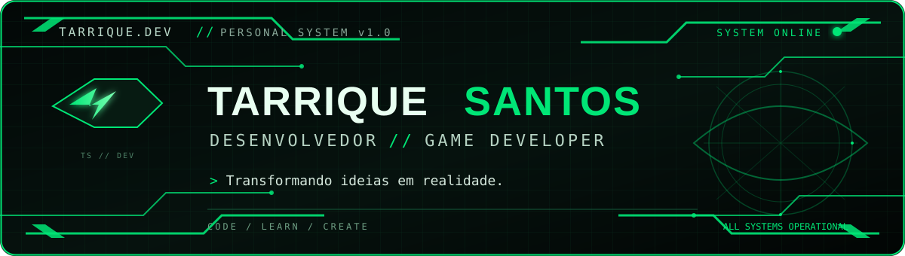

  

  
  
  
  
  
  

01 // SOBRE MIM
Olá! Eu sou o Tarrique Santos. 😎

Sou apaixonado por tecnologia, programação e desenvolvimento de jogos. Gosto de aprender na prática, explorar novas ferramentas e transformar ideias em projetos.

Foco: desenvolvimento de software e criação de jogos.
Code. Learn. Create.

02 // GITHUB TELEMETRY

  
  

03 // TECH STACK
LINGUAGENS

  
  
  
  
  
  

WEB & BACKEND

  
  
  
  

GAME DEVELOPMENT

  
  

DATABASES & FERRAMENTAS

  
  
  
  

04 // FEATURED PROJECT
🎮 G00D Protocol
Projeto de jogo 3D desenvolvido com Godot, com foco em ação, exploração, inimigos e mecânicas de combate.

  

  
    
  <code>TARRIQUE.DEV // ALL SYSTEMS OPERATIONAL</code>

